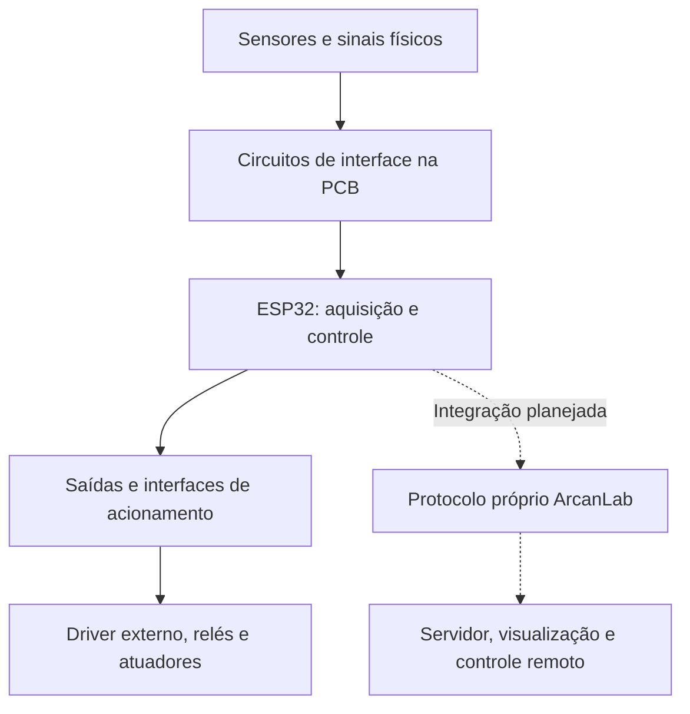

# Bancada de sensores e acionamentos ESP32

**Uma plataforma experimental de aquisição de dados físicos e controle de atuadores,  pronta para integração ao ArcanLab.**

## Sobre o projeto

Este repositório documenta a **bancada eletrônica baseada em ESP32** e sua placa de interface (*shield/PCB*). A placa reúne a alimentação, as conexões elétricas e os circuitos necessários para interligar sensores, entradas analógicas, saídas de acionamento e um driver externo de motor de passo.

O propósito é formar uma base física única para **observar fenômenos, adquirir medições e comandar dispositivos**. Em uma etapa seguinte, essa bancada será ligada ao **ArcanLab**, sistema maior de comunicação e gerenciamento remoto, por meio de um **protocolo próprio**, permitindo visualizar leituras no servidor e comandar os atuadores de modo autorizado.

Este repositório se concentra **exclusivamente na bancada e em sua evolução técnica**. A integração remota é um objetivo de desenvolvimento; não é apresentada como função já concluída.

> **Segurança.** Esta é uma bancada experimental, **não validada**. Antes de energizar, leia [docs/01 §8.3](docs/01-arquitetura-e-circuitos.md) e [docs/PENDENCIAS.md](docs/PENDENCIAS.md). Pontos de atenção: o regulador LM7805 pode superaquecer sem dissipador; as saídas BC337 sustentam só ~110 mA por canal; a entrada 4–20 mA sai da faixa linear do ADC acima de ~16 mA; e **nunca** se liga tensão de rede aos bornes `RELE_x`.

## O que a bancada reúne e em que estado está

A placa centraliza um **ESP32 DevKit**, conectores de parafuso, resistores de interface, um regulador de tensão, quatro estágios de saída com transistores e as conexões para sensores e módulos externos.

| Subsistema                  | Papel na bancada                   | Estado                                               | Documento                            |
| --------------------------- | ---------------------------------- | ---------------------------------------------------- | ------------------------------------ |
| **Motor de passo e driver** | Movimento por pulsos e direção     | **Girou** na bancada (GPIO18/19); sem ensaio angular | [04](docs/04-motor-de-passo.md)      |
| **Ultrassom HC-SR04**       | Distância pelo tempo de eco        | **Leituras** anteriores; sem calibração              | [05](docs/05-ultrassom-hc-sr04.md)   |
| **BMP180 / GY-68**          | Pressão e temperatura (I²C)        | **Não detectado** (scanner sem 0x77)                 | [03](docs/03-pressao-bmp180.md)      |
| **ACS712**                  | Corrente elétrica                  | Zero em repouso relatado; **sem ensaio com carga**   | [02](docs/02-corrente-acs712.md)     |
| **DS18B20**                 | Temperatura (1-Wire)               | Sem ensaio                                           | [06](docs/06-temperatura-ds18b20.md) |
| **Duas entradas 4–20 mA**   | Sinais de transmissores externos   | Sem ensaio; 3 pontos de projeto em aberto            | [07](docs/07-entradas-4-20ma.md)     |
| **Fluxo YF-S201**           | Contagem de pulsos de vazão        | Sem ensaio                                           | [08](docs/08-fluxo-yf-s201.md)       |
| **Quatro saídas BC337**     | Acionamento de bobinas e cargas DC | Sem ensaio; limite de ~110 mA por canal              | [09](docs/09-saidas-bc337.md)        |

A lista apresenta os **subsistemas contemplados**; não afirma que todos tenham sido ensaiados, nem simultaneamente. A arquitetura, a alimentação, o mapa de sinais e o plano de verificação estão em [docs/01](docs/01-arquitetura-e-circuitos.md).

## Como a placa funciona



**Aquisição:** sensores digitais enviam dados por GPIO, I²C ou 1-Wire; sensores analógicos passam por circuitos de adequação de nível e são lidos pelo ADC do ESP32.

**Acionamento:** o ESP32 fornece apenas **sinais de controle**. O motor de passo depende de um driver externo; as saídas de bobinas/cargas usam transistores e diodos de proteção. A potência dos motores **não vem dos GPIOs**.

**Alimentação:** o esquema tem entrada nominal de **12 V** e regulador **LM7805** para os **5 V**. O ESP32 opera em **3,3 V**. O driver do motor recebe alimentação de potência própria, separada dos sinais lógicos.

## Mapa de pinos

Fonte única: [`firmware/common/pins.h`](firmware/common/pins.h). Os valores abaixo seguem o esquema, exceto o motor (resultado do ensaio). Nenhuma ligação foi comprovada por continuidade.

| Função | GPIO | | Função | GPIO |
|---|---:|---|---|---:|
| Motor PUL / DIR | 18 / 19 | | ACS712 (ADC1) | 34 |
| HC-SR04 TRIG / ECHO | 14 / 13 | | 4–20 mA canais 1 / 2 (ADC1) | 39 / 36 |
| BMP180 SCL / SDA | 21 / 22 **(a conferir)** | | Saídas Q1 / Q2 / Q3 / Q4 | 32 / 33 / 25 / 26 |
| DS18B20 (1-Wire) | 4 | | Fluxo YF-S201 | 27 |

## Estrutura do repositório

```
README.md
docs/                  documentação técnica (01 a 09) e PENDENCIAS.md
firmware/
  common/              pins.h e bancada_calc.h: FONTE ÚNICA (edite aqui)
  <sketch>/            um sketch por subsistema (cópias de common/ geradas)
ensaios/               modelo de registro e registros de ensaios
figuras/               fotos, esquema, layout e diagramas (fontes .dot em figuras/fontes/)
tests/                 verificação no PC das fórmulas e da sintaxe dos sketches
tools/                 scripts de manutenção
Makefile
```

## Como usar

**Firmware (Arduino IDE):** abra `firmware/<sketch>/<sketch>.ino`, escolha a placa *ESP32 Dev Module* e a porta, e envie. Monitor serial a 115200. DS18B20 precisa das bibliotecas *OneWire* e *DallasTemperature*; os demais sketches não usam biblioteca externa. Comece pelo [`i2c_scanner`](firmware/i2c_scanner/i2c_scanner.ino) se o BMP180 não responder.

**Alterar um pino:** edite **somente** `firmware/common/pins.h` e rode `make pins`, que copia o arquivo para a pasta de cada sketch.

**Verificações no PC** (g++ e Python; Graphviz só para `figuras`):

| Comando | O que faz |
|---|---|
| `make` | confere as cópias comuns, as fórmulas dos docs, a sintaxe dos sketches e os links/pinos dos docs |
| `make figuras` | gera os PNG dos diagramas a partir de `figuras/fontes/*.dot` |
| `make pins` | atualiza as cópias de `pins.h` e `bancada_calc.h` nos sketches |

> `make` valida **fórmulas e sintaxe**, não substitui compilar para o ESP32 nem testar na bancada.

## Estado do desenvolvimento

A **bancada física e a PCB existem**. O **motor de passo possui um sketch que funcionou na montagem**; o **HC-SR04 já forneceu leituras**; o **BMP180 não foi detectado** e a causa está em aberto. Os demais subsistemas estão descritos com base nos desenhos elétricos e dependem de validação na montagem física. A lista completa do que falta está em **[docs/PENDENCIAS.md](docs/PENDENCIAS.md)**, e os registros de ensaio em [`ensaios/`](ensaios/).

## Objetivo: conexão ao ArcanLab

A integração transformará as leituras e os comandos locais em recursos acessíveis pelo **ArcanLab**:

1. O **ESP32** coleta medições e mantém o controle elétrico local.
2. Um componente de comunicação, a ser desenvolvido, conecta a bancada ao **protocolo próprio do ArcanLab**.
3. O **servidor** recebe leituras e estados para exibição e acompanhamento.
4. O controle remoto envia comandos **autorizados**, que o firmware valida antes de movimentar motores ou acionar cargas.

Formatos de mensagem, autenticação e intertravamentos serão definidos na implementação. **A integração ainda não foi desenvolvida**; o foco atual é consolidar os subsistemas locais como base técnica.
